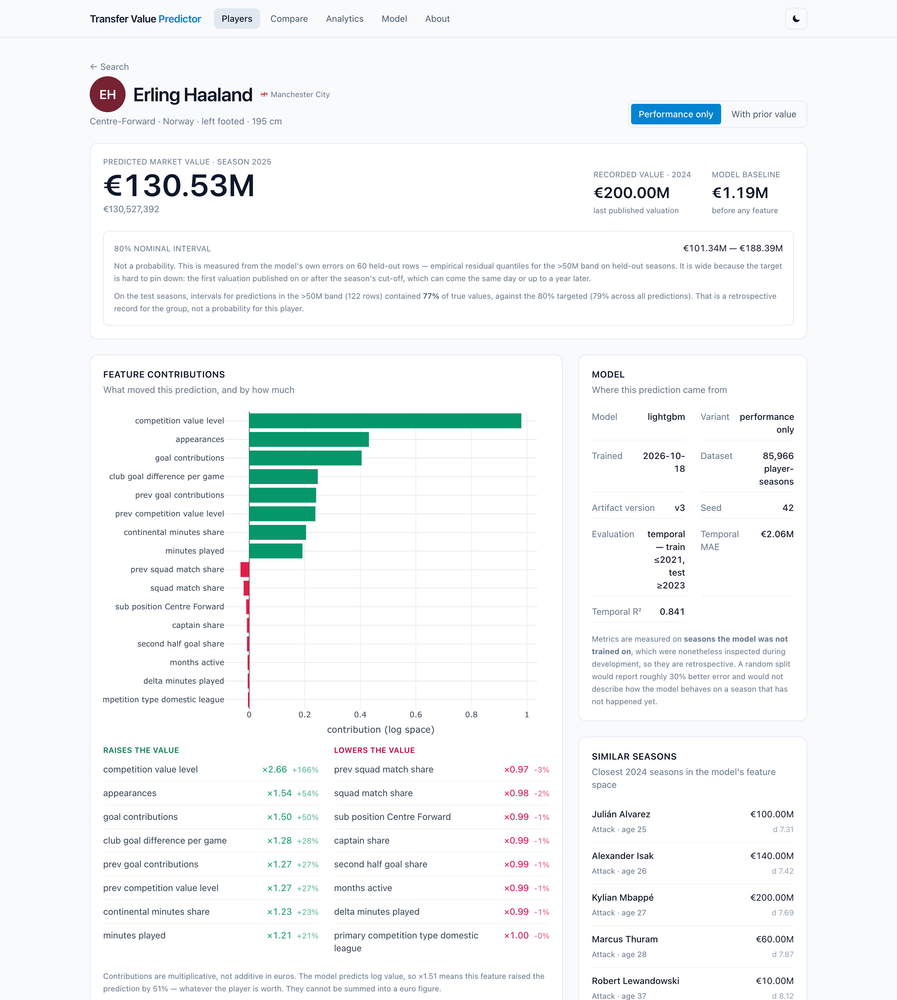
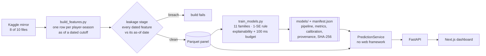
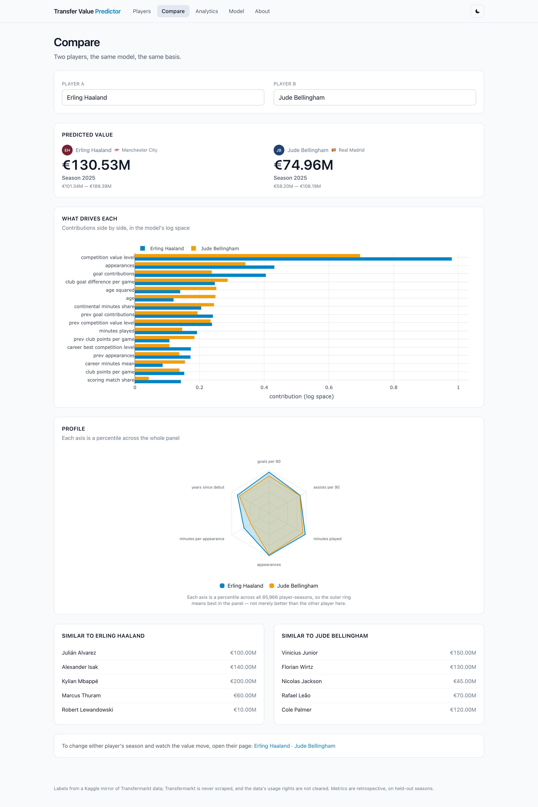

# Transfer Value Predictor

[](https://github.com/Vanshcloud/Transfer-Value-Predictor/actions/workflows/ci.yml)
[](https://www.python.org/downloads/)
[](LICENSE)
[](docs/DATASET_CARD.md#data-rights)
[](https://github.com/psf/black)
[](https://mypy-lang.org/)

Predict the next market valuation published for a professional footballer from
what happened on the pitch, explain every prediction, and say honestly how far to
trust it.

Search a player, get a valuation with an interval and the SHAP contributions
that produced it, see the seasons most like theirs in the model's own feature
space, then change the inputs and watch the number move. A FastAPI service and
a Next.js dashboard over models trained on a point-in-time player-season panel.



## What has and has not been demonstrated

| | |
|---|---|
| **Accuracy** | Test MAE **€2.06M** (R² 0.841) for the scouting model, **€0.91M** (R² 0.963) with a prior valuation, on seasons 2023–2024. **Retrospective**: the models were not fitted on those seasons, but the seasons were inspected during development ([`docs/EVALUATION.md`](docs/EVALUATION.md)). |
| **Uncertainty** | 80% intervals covered **79.1%** and **80.1%** of test values — also retrospective, and a frequency over groups of predictions, never a probability for one player. |
| **Independent check** | Prepared, not done: predictions for the 2025 season were [frozen and hashed](docs/prospective/2026-10-18-freeze.json) before any of their labels were in the project's data. The freeze is a local commit, not a public or third-party timestamp, and scoring it — which needs a later data refresh — would be out-of-time validation run by the author, not external validation. |
| **Leakage** | Every windowed feature carries the date of its newest input; a leakage stage checks each row against its as-of date and stops the build on a breach. |
| **Data rights** | **Uncertain and not cleared.** The data is a Kaggle mirror of Transfermarkt; Transfermarkt's terms prohibit ML training on its content ([Data rights](docs/DATASET_CARD.md#data-rights)). |
| **Deployment** | Built for a public, read-only demonstration, with request limits and load shedding; nothing is deployed from this repository. **Not production-ready**: it needs a reverse proxy for rate limits, timeouts and TLS ([`SECURITY.md`](SECURITY.md)). |

## Results

| Variant | Model | Validation MAE (2022) | Test MAE, 95% CI (players resampled) | Test R² | 80% interval coverage |
|---|---|---|---|---|---|
| Performance only — the scouting model | LightGBM | €1,892,889 | €2,057,285 (1.96M – 2.15M) | 0.841 | 79.1% |
| With prior value — tracks a known valuation | LightGBM | €900,232 | €908,625 (0.86M – 0.96M) | 0.963 | 80.1% |

The variants are scored on different rows (the second drops players never valued
before), so the two columns are not a comparison; on the 13,315 rows both score,
the prior value is worth **€1.17M** of MAE (1.10M – 1.24M). Season-to-season
variation is larger than any of these intervals: a rolling-origin backtest puts
the scouting model between €1.39M and €2.16M depending on the season.

> How the numbers were produced, what they are evidence of and how earlier
> p-values should be read: [`docs/EVALUATION.md`](docs/EVALUATION.md). Labels,
> features and model selection: [`docs/METHODOLOGY.md`](docs/METHODOLOGY.md).

## Quick start

No account and no download needed to run the test suite against the committed
sample — a few thousand rows copied from the Kaggle mirror, under the same
uncertain rights as the rest of the data ([Data rights](docs/DATASET_CARD.md#data-rights)):

```bash
make setup          # Python 3.13; on macOS first: brew install libomp
make test           # 862 pass, 70 skip — no data, no credentials
```

That is 862 passing tests and 70 skips. The full pipeline needs a free Kaggle
token in `.env` (see [`.env.example`](.env.example)):

```bash
python scripts/fetch_data.py        # Kaggle mirror -> data/processed (parquet)
python scripts/build_features.py    # point-in-time panel, leakage-checked
python scripts/train_models.py      # 11 families, selection rule, intervals
python scripts/build_reports.py     # model cards, SHAP, error analysis
make serve                          # API on :8000  (python -m api --reload)
cd frontend && npm ci && npm run dev # dashboard on :3000
```

Or `docker compose up --build` once data and models exist; compose mounts both
read-only.

## How it works



- **Point in time.** A row's features close at `max(1 July, last appearance)`
  and its label is the first valuation on or after that date, within a year — so
  the horizon varies by row (median 141 days) and the model is not told it. A
  prediction is the next published valuation, not the value on a fixed date.
  Lineups, club form, competition strength, prior values and career momentum
  each carry the date of their newest input, and the leakage stage checks every
  one per row — the check that found the leaks fixed in Phase 19.
- **Selection is a written rule, not `min()`.** Eligible families must expose
  feature importances and explain a prediction within 100 ms; among those within
  one standard error of the best validation MAE, the smallest deployed footprint
  wins. No test metric enters it, and every artifact records the inputs, so the
  choice can be recomputed.
- **Intervals are measured, not assumed.** Residual quantiles from the validation
  season, widened by a rule fixed on pre-test seasons to hold coverage one and two
  seasons ahead. Each response quotes its own value band's record and row count.
- **Explanations are exact and in the right unit.** SHAP values are additive in
  log space, so each is also served as a multiplier (`effect_multiplier`) rather
  than as a euro amount, which would be false for a log-target model.
- **Artifacts are self-describing.** Fitted preprocessing travels inside the
  model; `models/manifest.json` names the file each variant serves with its
  SHA-256, checked before unpickling; provenance records the commit, the
  environment and a hash of every input table.

## API

```bash
make serve        # python -m api --reload; interactive docs at /docs
```

All twelve endpoints. [`docs/API_CONTRACT.md`](docs/API_CONTRACT.md) is the
contract, and a test diffs it, this table and the live OpenAPI document in every
direction.

| Method | Path | What it answers |
|---|---|---|
| `GET` | `/health` | Alive? 200 even when degraded, with readiness in the body. Unversioned. |
| `GET` | `/ready` | Can it predict? 503 until a model is loaded, for a readiness probe. |
| `POST` | `/api/v1/predict` | What is this player worth, and why? |
| `GET` | `/api/v1/players` | Which players match this name? |
| `GET` | `/api/v1/players/{player_id}` | Every season on file, plus a what-if seed. |
| `GET` | `/api/v1/players/{player_id}/similar` | Whose season most resembles this one? |
| `GET` | `/api/v1/players/{player_id}/history` | Predicted against actual, season by season. |
| `GET` | `/api/v1/features/distribution` | Where does a value sit in the population? |
| `GET` | `/api/v1/models` | Which variants are loaded? |
| `GET` | `/api/v1/models/{variant}` | Family, params, features, training data. |
| `GET` | `/api/v1/models/{variant}/metrics` | Validation and test metrics, in EUR. |
| `GET` | `/api/v1/models/{variant}/feature-importance` | What the model leans on, and global SHAP. |

`POST /api/v1/predict` takes a `player_id` or an explicit `features` map. Unknown
feature names, values outside what the feature's definition allows (a share above
1, 2.5 goals, an integer past float range) and non-text categories are refused
with a `422` naming the feature; nothing is clamped. Every error, in OpenAPI and
on the wire, uses one envelope. The service layer imports no web framework, which
is why the 123 tests for prediction logic need no running server.

## Dashboard

| Page | What it answers |
|---|---|
| `/players` | Which player? Modellable ones first. |
| `/players/[id]` | What are they worth, why, next to whom — and what if? |
| `/compare` | How do two players differ? Each value carries its season, with a warning when they differ. |
| `/analytics` | How is value distributed across the panel? |
| `/model` | How good is this model, and why was it chosen? |
| `/about` | Where the data came from and where not to trust it. |



```bash
cd frontend && npm test        # 124 tests
```

Only the newest request for a search box, a comparison side or a what-if slider
may change the screen, so a slow earlier response cannot land on a later choice.
Every chart carries a table of its own numbers for screen readers — series as
columns, axis titles as headers, histogram bins as rows. Details in
[`frontend/README.md`](frontend/README.md).

## Testing

```bash
make test        # 862 pass, 70 skip — no data, no credentials
make test-cov    # the same, with coverage; fails under 88%
pytest           # everything; integration tests run when data and models exist
```

On a clean clone with no data, `pytest` reports zero failures — verified on a fresh clone: 862
pass and the 70 integration tests skip. With the Kaggle download and trained
models, all 932 pass.

| | Coverage | Tests |
|---|---|---|
| `make test-cov` — no credentials, no data | **90%** | 862 pass, 70 deselected |
| `make test-cov-all` — needs the download and trained models | **97%** | 932 collected |

Tests that construct the leak they guard against, tests that recompute this
README's numbers, a contract test that provokes every documented error status,
and race tests that resolve the earlier request last.

## Known limitations

- **Retrospective evidence only** until the prospective freeze is scored.
- **Wide intervals.** A median width of €2.2M for the scouting model; they still
  cover less than 80% below €1M and above €50M.
- **Labels are community appraisals,** not prices paid, and reproduce
  Transfermarkt's consensus including its biases. Transfer fees cover 8.5% of rows
  and only players who were sold; the fee helper is experimental, with no training
  command.
- **Error grows with value,** so a mid-table MAE hides large misses at the top of
  the market. Coverage begins in 2012, and seasons run August to July for every
  league.
- **Season-level shifts** are not in any interval quoted here; the backtest shows
  they are larger than within-season noise.
- **Some rows may never be labelled.** 1,007 season-2024 rows are still awaiting a
  label; most belong to players nobody has revalued since, and leave the panel
  when their window closes.

Each is measured rather than asserted in [`docs/METHODOLOGY.md`](docs/METHODOLOGY.md).

## Documentation

| | |
|---|---|
| [`docs/EVALUATION.md`](docs/EVALUATION.md) | What the metrics prove, the frozen protocol, the prospective test, the statistical review |
| [`docs/METHODOLOGY.md`](docs/METHODOLOGY.md) | Labels, features, selection, intervals, limitations — with the measurements |
| [`docs/DATASET_CARD.md`](docs/DATASET_CARD.md) | The data, its gaps and its rights |
| [`docs/MODEL_CARD_performance_only.md`](docs/MODEL_CARD_performance_only.md) · [`with_prior_value`](docs/MODEL_CARD_with_prior_value.md) | Generated per model, with interval coverage by season and band |
| [`docs/API_CONTRACT.md`](docs/API_CONTRACT.md) | The HTTP contract |
| [`docs/EXPERIMENT_TRACKING.md`](docs/EXPERIMENT_TRACKING.md) | What an artifact records, and how the served one is chosen |
| [`SECURITY.md`](SECURITY.md) | Threat model and deployment safeguards |
| [`plans/`](plans/) | The phase-by-phase record, including every audit and what it found |
| [`CHANGELOG.md`](CHANGELOG.md) · [`ROADMAP.md`](ROADMAP.md) · [`CONTRIBUTING.md`](CONTRIBUTING.md) · [`PROJECT_STRUCTURE.md`](PROJECT_STRUCTURE.md) | |

## Author, citation and licence

A single-author project by Vansh Tomar; `scripts/hooks/commit-msg` rejects
co-author trailers and AI attribution markers.

```bibtex
@software{tomar_transfer_value_predictor,
  author = {Tomar, Vansh},
  title  = {Transfer Value Predictor: explainable market-value estimation for professional footballers},
  year   = {2026},
  url    = {https://github.com/Vanshcloud/Transfer-Value-Predictor}
}

@misc{cariboo_player_scores,
  author       = {Cariboo, David},
  title        = {Football Data from Transfermarkt},
  howpublished = {Kaggle dataset \texttt{davidcariboo/player-scores}},
  note         = {Published as CC0 1.0 by its maintainer; built from Transfermarkt data},
  url          = {https://www.kaggle.com/datasets/davidcariboo/player-scores}
}
```

The code is MIT ([`LICENSE`](LICENSE)). The data is not: its publisher dedicates
the mirror as CC0, Transfermarkt's own Terms of Use §11.1 prohibit automated
access (so nothing here contacts Transfermarkt) and also prohibit ML training on
the content, which this project does through the mirror. Whether the mirror's
dedication covers that is not established and the project has no legal clearance
— see [Data rights](docs/DATASET_CARD.md#data-rights). `data/sample/` commits a
small extract of the mirror as a test fixture, so the repository does
redistribute some raw rows under that same uncertainty. Labels are the work of
Transfermarkt's contributor community, and the mirror is maintained by David
Cariboo.
